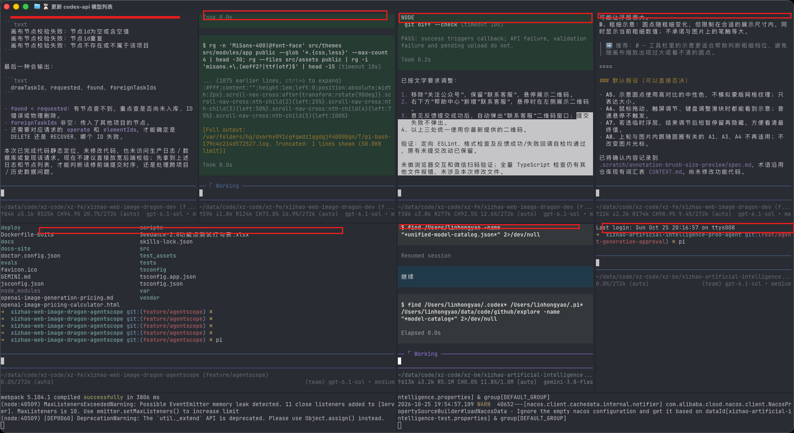
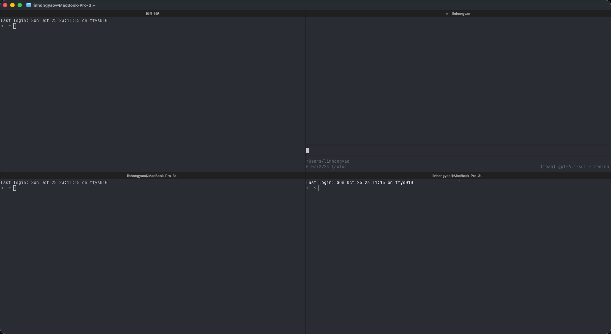

# Ghostty macOS Native Per-Split Title Bar

> **Always-visible, per-pane title bar for Ghostty on macOS with dynamic terminal title (OSC 0/2) synchronization and inline renaming.**

---

## 痛点与背景 (The Problem)

在多任务开发场景中（例如在平铺分栏中同时运行多个 AI 辅助编程会话：Pi Agent、Codex、Claude Code，或者多模块编译/微服务监控），屏幕会被划分为 4~8 个并发分栏（splits）。



原生 Ghostty 的分栏是纯终端区域，**分栏内部没有任何标题或标识条**，全窗口只有一个主标题跟随当前聚焦的 pane：
1. 无法一眼看出每个分栏正在跑什么任务或属于哪个会话；
2. 一旦输出滚屏填满，必须手动点击切换聚焦才能看到窗口标题变化；
3. 传统使用 tmux 的方案存在搜索断层（无法使用 `Cmd+F` 原生终端搜索）、剪贴板与滚屏操作割裂等“一套又一套”的沉重心智负担。

---

## 解决方案 (The Solution)

本分支在 macOS 平台实现了原生的 **`SurfaceTitleBar`**（22px 高的原生毛玻璃标题条），叠加在每个 split surface 的顶部：



### 核心特性

1. **终端动态标题优先（Dynamic Session Title Priority）**：
   - 优先读取由终端程序通过标准 ANSI/OSC 转义序列（`OSC 0` / `OSC 2`）发送的标题（`surfaceView.title`）；
   - **完美适配 AI 编程助手（Pi / Codex / Claude Code）**：会话状态 emoji（`⏳` 运行中、`✅` 已完成、`π` 空闲）与会话主题名（`/rename`、`/ai-rename` 结果）会实时、自动同步呈现在每个分栏顶部；
   - 终端未设置标题时，自动回退展示当前工作目录名（`pwd.lastPathComponent`）；
2. **零空间浪费（Smart Visibility）**：
   - 单分栏（未分屏）时自动隐藏标题条，100% 保持终端原有高度与极简外观；
   - 只有在触发分栏（`Cmd+D` 或 `Cmd+Shift+D`）时，各个分栏顶部才会展开专属标题条；
3. **原生内联双击改名（Inline Rename）**：
   - 鼠标双击任意分栏顶部的标题条，直接唤起内联输入框固定自定义名称；
   - 支持快捷键交互：`Enter` 确认保存，`Esc` 取消恢复，失焦自动提交；
4. **100% 保留原生体验与快捷键**：
   - 快捷键（`Cmd+D`、`Cmd+[` / `Cmd+]`、`Cmd+Shift+Enter` 放大等）完全原生；
   - 原生文本搜索（`Cmd+F`）、Metal 硬件加速渲染与 ProMotion 120Hz 保持全速，无需通过 tmux 等中间代理层。

---

## 构建与安装指南 (Build & Install)

### 环境要求
- macOS 15+ 或 macOS 26 Tahoe
- Xcode 16+ / Xcode 27+（已安装并执行 `xcodebuild -downloadComponent MetalToolchain`）
- Zig 0.15.2（通过 `brew install zig@0.15`）

### 编译步骤
```bash
# 1. 编译底层库（ReleaseFast 模式，无 Debug 性能损失）
zig build -Doptimize=ReleaseFast -Demit-macos-app=false -Dxcframework-target=native

# 2. 编译 macOS 原生应用
cd macos
xcodebuild -project Ghostty.xcodeproj -scheme Ghostty -configuration ReleaseLocal -arch arm64 SYMROOT=build clean build

# 3. 安装到应用程序目录
cp -R build/ReleaseLocal/Ghostty.app /Applications/Ghostty-SplitTitles.app
```
